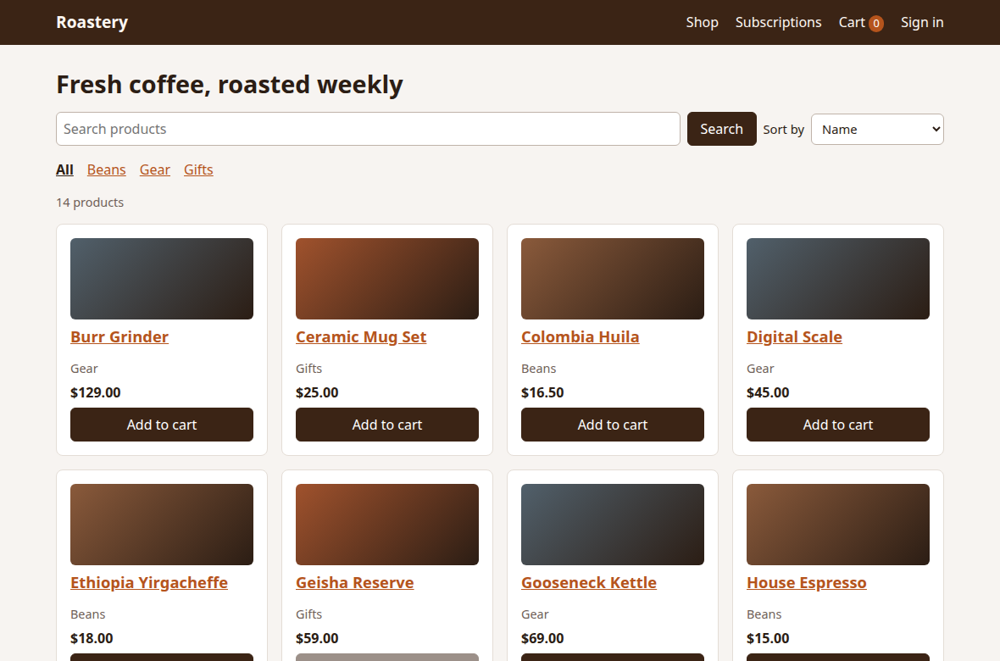
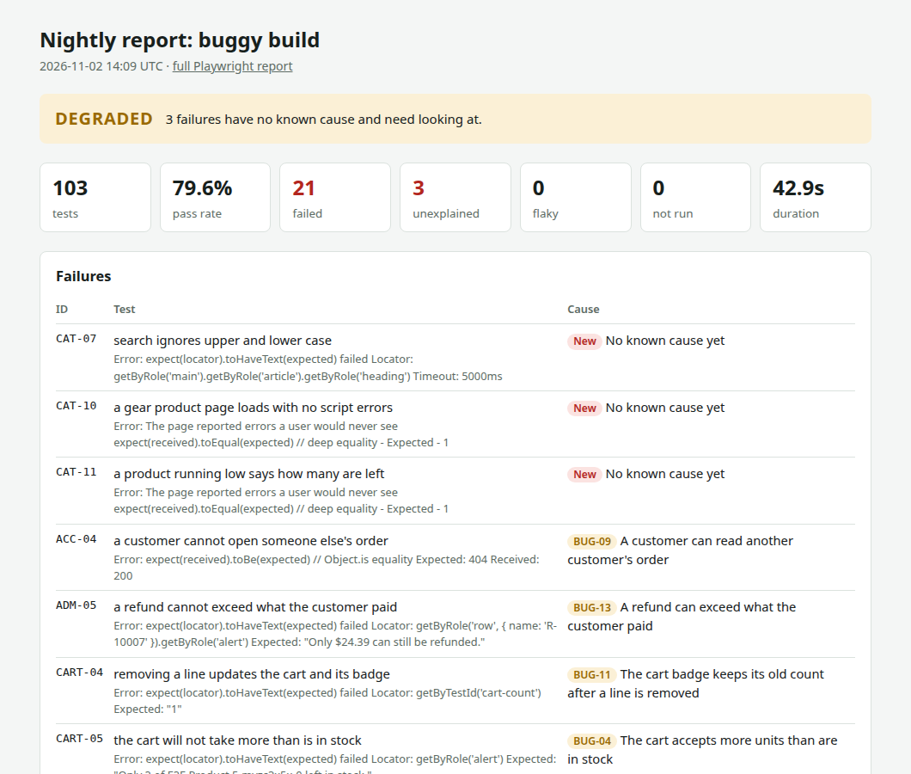

# Playwright Commerce E2E

An end-to-end test framework built for nightly runs with Playwright and TypeScript, tested against **Roastery**, a demo coffee shop with a cart, checkout, three ways to pay, and subscription billing.

The demo shop ships inside this repository, so everything runs on your own machine with no accounts, keys or paid services. It also has a switch that plants 14 realistic bugs, which shows the suite catching real defects rather than only passing.



## Results from a real run

The same tests run against two builds of the shop.

| Build       | Tests | Passed | Failed | Signal   | Time |
| ----------- | ----: | -----: | -----: | -------- | ---: |
| Clean       |   109 |    109 |      0 | HEALTHY  |  18s |
| Seeded bugs |   103 |     82 |     21 | DEGRADED |  43s |

All 14 planted bugs were caught, and nothing unrelated failed. Of the 21 failures, 18 match known defects and 3 are deliberately left unknown, so the report shows what a new problem looks like. The clean build has 6 extra runs because the critical journeys repeat on a phone-sized screen.



## What it demonstrates

- **Page objects and a typed API client**, so tests read like the journey they check.
- **API set-up, UI verification.** A checkout test puts items in the cart through the API and spends its time on checkout.
- **Isolated test data.** Each test gets its own new customer, and everything it creates is deleted afterwards, even when it fails.
- **Parallel runs.** No test depends on another, so the suite runs on four workers.
- **A console guard** that fails a test on hidden script errors, even when the page looks fine.
- **Tests that fail on bugs.** There are no workarounds. Known failures go in a defect map, so the report can tell old problems from new ones.
- **An executive report** with a HEALTHY, DEGRADED or BLOCKED signal, failures with causes, a run-over-run trend, coverage by area and flaky tests.
- **Automatic issue filing** on GitHub, with a signature on each issue so a test that keeps failing files only once.
- **A generated test inventory**, so the catalogue of tests can't fall out of date.
- **Ready-made GitHub pipelines** for the fast checks and the full run. They start by hand, and a small edit puts them on a nightly schedule.

## Quick start

You need [Node.js 20](https://nodejs.org) or newer.

```bash
npm ci
```

```bash
npx playwright install chromium
```

```bash
npm test
```

Playwright starts the shop by itself, runs the tests and stops it again.

| Command               | What it does                                                 |
| --------------------- | ------------------------------------------------------------ |
| `npm run app`         | Starts the shop to browse at http://localhost:3000           |
| `npm run app:bugs`    | Starts the shop with every bug at http://localhost:3001      |
| `npm test`            | Runs the full suite on the clean build, plus the phone run   |
| `npm run test:smoke`  | Runs only the 6 critical journeys                            |
| `npm run test:bugs`   | Runs the full suite on the seeded-bug build                  |
| `npm run test:ui`     | Opens Playwright's interactive runner                        |
| `npm run nightly`     | Does the whole nightly: both builds and their reports        |
| `npm run report:open` | Opens the Playwright report from the last `npm test`         |
| `npm run check`       | Runs types, lint, the inventory check and the report's tests |

After `npm run nightly`, open `report/index.html` to read the results.

## Project layout

```text
app/                 Roastery, the demo shop (Node.js with no dependencies)
e2e/
  api/               Typed client for the shop's API
  data/              Test cards, products, addresses
  fixtures/          Sign-in, per-test customers, cleanup, the console guard
  pages/             Page objects, one file per area
  reporting/         The executive report, its tests, the known-defect map
  specs/             The tests, one folder per area
scripts/             The nightly runner and the inventory generator
docs/                Everything below
.github/workflows/   GitHub pipelines, started by hand
playwright.config.ts Browsers, builds, retries, timeouts, reporters
```

## Documentation

- [Framework guide](docs/GUIDE.md): what was built, how it was set up step by step, and how to add a test. Start here.
- [Demo app](docs/DEMO-APP.md): the shop's features, accounts, coupons, test cards and API.
- [Seeded bugs](docs/SEEDED-BUGS.md): each planted bug and the tests that catch it.
- [Test inventory](docs/TEST-INVENTORY.md): every test, generated from the code.

## About the payments

Roastery uses a mock payment gateway that runs inside the app. Only a fixed list of test card numbers is accepted, and the number alone decides the outcome, the way a real provider's test mode works. No real payment service is involved, and a real card is refused.
