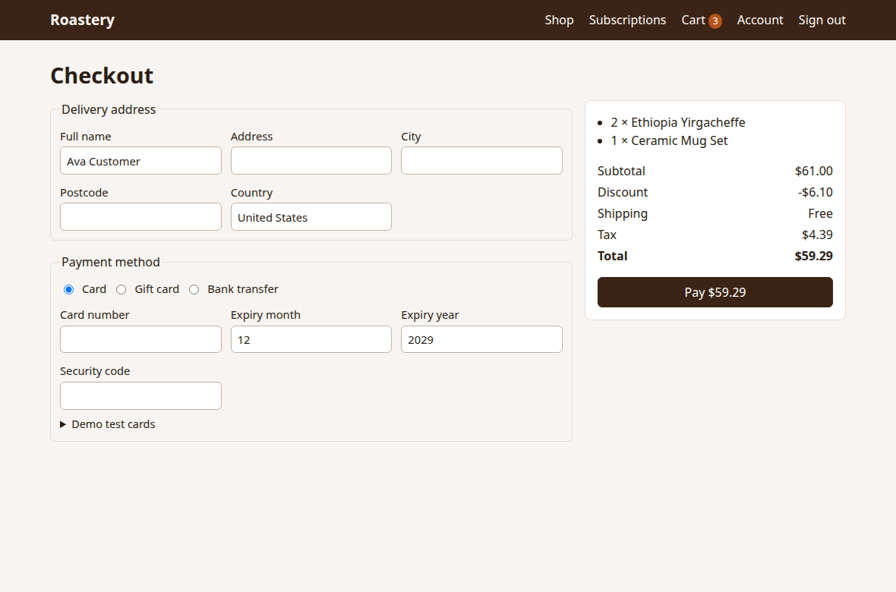
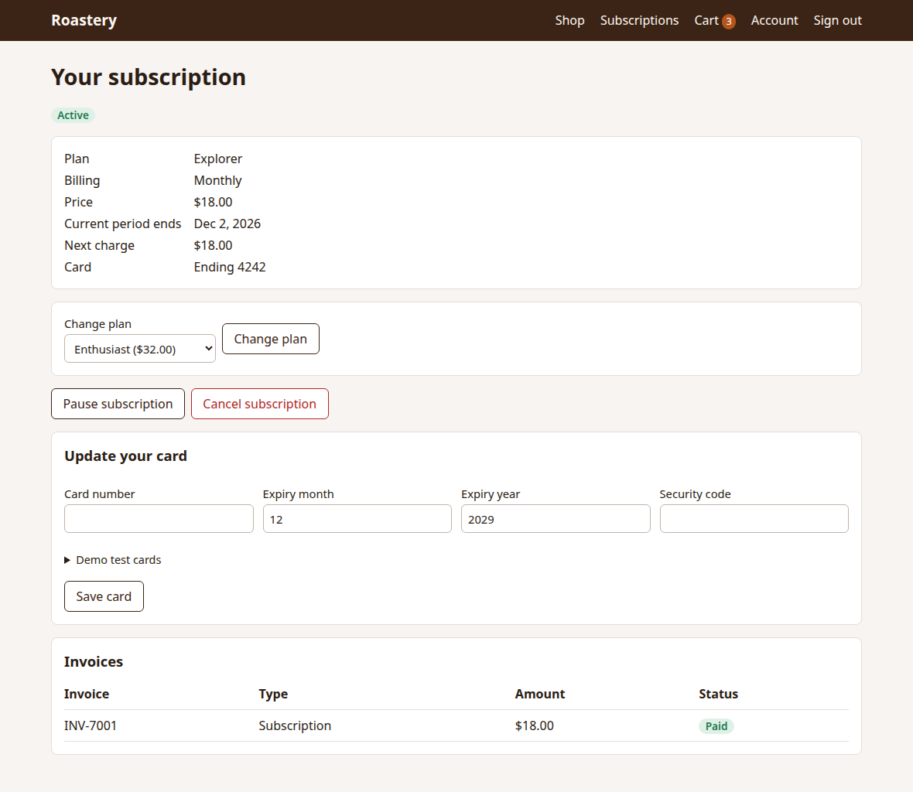

# The Roastery demo app

Roastery is a small coffee shop built for this project, so the tests have a realistic e-commerce and subscription app to run against. It's plain Node.js with no dependencies, and all its data lives in memory, so restarting it resets the shop.

```bash
npm run app
```

Then open http://localhost:3000. Use `npm run app:bugs` for the version with every seeded bug, at http://localhost:3001.



## What it can do

**Shopping**

- Catalogue with search, category filter, sorting and paging
- Product pages with stock levels, including low-stock and sold-out states
- Cart that works for guests and carries over when they sign in
- Coupons: percentage off, fixed amount off, free shipping, minimum spend, expiry
- Standard and express shipping, free standard shipping from $50, and 8% tax

**Payment**

- Card, through the mock gateway, including a 3-D Secure confirmation step
- Gift card
- Bank transfer, where the order waits until staff mark it paid
- Declines, insufficient funds, expired cards and mistyped numbers

**Subscriptions**

- Three plans, billed monthly or annually, with two months free on annual
- A 14-day free trial on the Enthusiast plan
- Upgrades charged at a prorated difference, and downgrades that wait for the next renewal
- Pause, resume, cancel at period end, and changing your mind before it ends
- Renewals with invoices, and failed payments that go past due
- Card updates, payment retries, and cancellation after three failed renewals

**Admin**

- Orders, full and partial refunds, and marking bank transfers paid
- Products, coupons and gift cards
- An overview of subscribers, with revenue and monthly recurring revenue



## Demo accounts

These only exist in the local demo.

| Role     | Email                 | Password             |
| -------- | --------------------- | -------------------- |
| Admin    | `admin@roastery.test` | `admin-demo-pass`    |
| Customer | `ava@roastery.test`   | `customer-demo-pass` |

## Test cards

Any future expiry date and any 3-digit security code will work. Any other number is refused, so a real card can't be used.

| Card number           | What happens                       |
| --------------------- | ---------------------------------- |
| `4242 4242 4242 4242` | Approved                           |
| `4000 0000 0000 0002` | Declined                           |
| `4000 0000 0000 9995` | Insufficient funds                 |
| `4000 0000 0000 3220` | Asks for 3-D Secure confirmation   |
| `4000 0000 0000 0341` | Works today, then fails at renewal |

## Coupons and gift cards

| Code           | Effect                           |
| -------------- | -------------------------------- |
| `WELCOME10`    | 10% off                          |
| `SAVE5`        | $5 off a subtotal of $30 or more |
| `FREESHIP`     | Free standard shipping           |
| `SUMMER23`     | Expired, always refused          |
| `GIFT-25-DEMO` | Gift card with $25.00 on it      |

## Plans

| Plan           | Bags a month | Monthly |  Annual | Trial                 |
| -------------- | -----------: | ------: | ------: | --------------------- |
| Explorer       |            1 |  $18.00 | $180.00 | None                  |
| Enthusiast     |            2 |  $32.00 | $320.00 | 14 days, monthly only |
| Roaster's Club |            4 |  $58.00 | $580.00 | None                  |

## API

All responses are JSON, and all money is in cents. Errors look like `{"error": {"code": "...", "message": "...", "field": "..."}}`.

| Area          | Endpoints                                                                                                                                                                                         |
| ------------- | ------------------------------------------------------------------------------------------------------------------------------------------------------------------------------------------------- |
| Account       | `POST /api/auth/register`, `POST /api/auth/login`, `POST /api/auth/logout`, `GET /api/me`                                                                                                         |
| Catalogue     | `GET /api/products`, `GET /api/products/:slug`, `GET /api/plans`                                                                                                                                  |
| Cart          | `GET /api/cart`, `POST /api/cart/items`, `PATCH` and `DELETE /api/cart/items/:id`, `POST` and `DELETE /api/cart/coupon`, `PUT /api/cart/shipping`                                                 |
| Checkout      | `POST /api/checkout`, `POST /api/checkout/challenge/:id`                                                                                                                                          |
| Orders        | `GET /api/orders`, `GET /api/orders/:id`                                                                                                                                                          |
| Subscriptions | `GET /api/subscription`, `POST /api/subscriptions`, then `POST /api/subscriptions/:id/` with `change-plan`, `cancel`, `keep`, `pause`, `resume` or `retry`, and `PUT /api/subscriptions/:id/card` |
| Admin         | Everything under `/api/admin/`                                                                                                                                                                    |

### Settings

| Variable      | Default | Purpose                                           |
| ------------- | ------- | ------------------------------------------------- |
| `PORT`        | `3000`  | The port to run on                                |
| `SEEDED_BUGS` | Empty   | `all`, or a list such as `BUG-03,BUG-07`          |
| `TEST_HOOKS`  | Off     | `1` adds `POST /api/test/subscriptions/:id/renew` |

A billing period can't pass during a test, so the test hook runs whatever the end of the period would run. It only exists when `TEST_HOOKS=1`.
