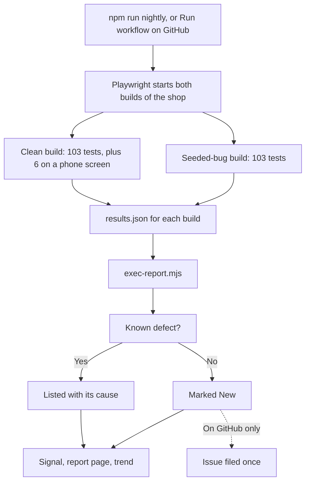

# Framework guide

This guide explains what was built, how it fits together, and how it was set up. You don't need to read the code first.

## The big picture

There are two parts:

1. **The app under test.** Roastery is a small coffee shop in the `app/` folder.
2. **The test framework.** Everything in `e2e/`, plus the config, scripts and pipelines around it.

The tests never reach inside the app. They use it the way a person or another program would, through the browser and through its web API. To point them at a different site, you would change the tests and page objects, not the structure.

This is what happens on a nightly run:



## What each folder does

| Folder               | Job                                                                                                                                                                                                                                      |
| -------------------- | ---------------------------------------------------------------------------------------------------------------------------------------------------------------------------------------------------------------------------------------- |
| `app/`               | The demo shop. `server.mjs` is the web server and API, `shop.mjs` holds cart and order rules, `billing.mjs` holds subscriptions, `gateway.mjs` is the mock payment provider, `bugs.mjs` is the bug switch, and `public/` is the website. |
| `e2e/api/`           | `ShopApi` wraps every API call in a typed method, such as `customer.api.buy(productId)`.                                                                                                                                                 |
| `e2e/data/`          | Fixed test data: cards, seeded products and plans, an address.                                                                                                                                                                           |
| `e2e/fixtures/`      | What each test gets handed: page objects, a new customer, an admin session. Also holds the console guard.                                                                                                                                |
| `e2e/pages/`         | Page objects. All knowledge of how a screen is laid out lives here.                                                                                                                                                                      |
| `e2e/specs/`         | The tests themselves.                                                                                                                                                                                                                    |
| `e2e/reporting/`     | The report generator, its tests, and the known-defect map.                                                                                                                                                                               |
| `scripts/`           | `nightly.mjs` runs everything. `inventory.mjs` writes the test catalogue.                                                                                                                                                                |
| `.github/workflows/` | `ci.yml` holds the fast checks and `nightly.yml` the full run. Both start by hand.                                                                                                                                                       |

## How it was set up, step by step

### 1. Project and tooling

A new Node project with Playwright, TypeScript, ESLint and Prettier. The Playwright version is pinned exactly, because a browser update can change results overnight. `npm run check` runs the type check, lint rules, inventory check and report tests.

ESLint has Playwright's rules turned on, and three of them matter most: no skipped tests, no `.only`, and no fixed waits.

### 2. The Playwright config

`playwright.config.ts` is the control panel:

- **Projects.** `buildProjects()` creates the same tests once per build, `stable` and `buggy`, each with a sign-in job that runs first. `stable-mobile` repeats the `@smoke` tests on a Pixel 7 screen.
- **webServer.** Playwright starts both builds of the shop, on ports 4173 and 4174, and stops them afterwards. The seeded-bug build is the same code with `SEEDED_BUGS=all`.
- **Timeouts.** A click on a missing element fails after 10 seconds, so one broken test can't eat a whole run.
- **Evidence.** A failed test keeps its screenshot, video and trace.
- **Retries.** One retry in CI, none locally. A test that passes only on retry is reported as flaky, not passed.

### 3. The API client

`ShopApi` turns the shop's API into typed methods, and every method throws if the server answers with the wrong status. A broken set-up step then fails with a clear message instead of confusing the test later.

Tests that check a refusal use `api.http` directly, because for them the refusal is what's being tested.

### 4. Fixtures

Fixtures are the framework's core. A test lists what it needs, and Playwright builds it first and cleans it up afterwards.

```ts
test('PAY-03 > a card without enough funds is refused', async ({ shop, customer }) => {
```

| Fixture                       | What the test gets                                                                |
| ----------------------------- | --------------------------------------------------------------------------------- |
| `shop`                        | All the page objects                                                              |
| `customer`                    | A brand-new account, already signed in to the browser, deleted when the test ends |
| `newCustomer()`               | More customers, for tests that need two people                                    |
| `admin`                       | The API signed in as staff, reusing one saved login                               |
| `guestApi`                    | The API with no session                                                           |
| `newProduct()`, `newCoupon()` | Throwaway data, deleted when the test ends                                        |
| `consoleGuard`                | Runs on every test by itself (see below)                                          |

Each test having its own customer is what makes parallel running safe. No two tests share a cart or a subscription, so they can't interfere and can run in any order.

### 5. Page objects

A page object describes one screen. Tests say what to do, and the page object knows how.

```ts
await shop.checkout.payByCard(goodCard());
```

If the checkout layout changes, one file changes and every test keeps working. Locators prefer what a user sees, such as roles and labels, and use test IDs only for values like totals.

### 6. The tests

Each test checks one thing, and each has a unique ID in its title, like `PAY-01 > ...`. The ID is how the report, the defect map and the inventory refer to it. The `@smoke` tag marks the critical journeys.

Here's a real test, with what each part does:

```ts
test.beforeEach(async ({ customer }) => {
  await customer.api.addToCart(yirgacheffe.id); // Fast set-up through the API
});

test('PAY-01 > an approved card places the order', { tag: '@smoke' }, async ({ shop, customer }) => {
  await shop.checkout.open(); // The part being tested, in the browser
  await shop.checkout.payByCard(goodCard());

  await expect(shop.order.heading).toHaveText(/^Order R-\d+$/); // What the customer sees
  await expect(shop.order.status).toHaveText('Paid');
  await expect(shop.order.total).toHaveText('$24.39');
  await expect(shop.order.paidBy).toHaveText('Card ending 4242');
  await expect(shop.header.cartCount).toHaveText('0');

  expect(await customer.api.orders()).toHaveLength(1); // What really happened on the server
});
```

Afterwards the `customer` fixture deletes the account and the order with it.

### 7. The console guard

A page can look perfect while its scripts are failing. The console guard runs on every test, watches for script errors, console errors and server errors, and fails the test if any appear.

`BUG-12` shows why this matters: a gear product page looks fine, but a script dies behind it. No visible check could catch that, and the guard does. Errors that are normal, such as the browser logging a refused request, are listed in `e2e/fixtures/expected-errors.ts`. Keep that list short, because each entry is something no test will notice again.

### 8. The report

`e2e/reporting/exec-report.mjs` reads Playwright's JSON results and writes a page someone can read in a minute. It answers one question first: do I need to do anything today?

| Signal       | Meaning                                                                     |
| ------------ | --------------------------------------------------------------------------- |
| **HEALTHY**  | Everything passed, or every failure is a known defect                       |
| **DEGRADED** | At least one failure has no known cause                                     |
| **BLOCKED**  | A `@smoke` test failed with no known cause, or most of the suite didn't run |

A test that fails on a known bug is doing its job, so it doesn't make the report alarming. Only something new does. The report also flags the opposite case: a known defect that stopped failing, which may mean it's fixed.

### 9. Known defects and issues

Tests never work around a bug. They fail, and the failure gets explained in one of two ways:

- **`e2e/reporting/known-defects.json`** maps a test ID to its bug.
- **GitHub issues.** On GitHub, each new failure gets one issue containing a signature, a short code made from the test's name. The next run's report searches for that code, finds the issue and files nothing new. A closed issue that fails again is reported as a regression.

Filing stops at 5 issues in one run, because that many new failures usually share one cause. If GitHub can't be reached, nothing is filed, so that no duplicates appear. These rules are covered by the tests in `e2e/reporting/exec-report.test.mjs`, which use a fake GitHub on your own machine.

Without a token, the report contacts nothing.

### 10. The nightly runner and the pipelines

`scripts/nightly.mjs` runs each build, builds each report and writes `report/index.html`. A failed test doesn't stop the run or fail the script, because a nightly's job is to report.

GitHub Actions calls the same script, so a run on your machine and one on GitHub do the same thing.

| Workflow      | When              | What it runs                                |
| ------------- | ----------------- | ------------------------------------------- |
| `ci.yml`      | When you start it | `npm run check` and the smoke tests         |
| `nightly.yml` | When you start it | `npm run nightly`, then uploads the reports |

Neither runs by itself. Each file has its automatic triggers commented out, so turning on a schedule is a small edit.

## How to add a test

Say you want to check that a bank transfer order shows the right total.

1. **Pick the file and the next ID.** Payment tests are in `e2e/specs/checkout/`, and the next free ID is in `docs/TEST-INVENTORY.md`.
2. **Write the test.** Set up through the API, act in the browser, check the result.

   ```ts
   test('PAY-15 > a bank transfer order shows the amount to send', async ({ shop }) => {
     await shop.checkout.open();
     await shop.checkout.payByBankTransfer();

     await expect(shop.order.bankInstructions).toContainText('$24.39');
   });
   ```

3. **Add anything missing to a page object.** Don't put locators in the test.
4. **Run just that test.**

   ```bash
   npx playwright test --project=stable --grep PAY-15
   ```

5. **Update the inventory and check everything.**

   ```bash
   npm run inventory
   ```

   ```bash
   npm run check
   ```

## When a test fails

1. Open the report. The failure's error message comes first.
2. Run `npm run report:open` for the screenshot, video and trace.
3. Decide what it is:
   - **A test mistake:** fix the test.
   - **A product bug:** leave the test failing, record the bug, and add it to `known-defects.json`.

## Trying the bug switch

Each bug can run alone. This starts a shop with one bug, then runs the suite against it. Run the first command in one terminal and the second in another.

```bash
SEEDED_BUGS=BUG-03 PORT=4174 TEST_HOOKS=1 node app/server.mjs
```

```bash
npm run test:bugs
```

Only `CART-09` fails. Playwright uses the shop you started instead of starting its own.

## Uploading to GitHub

Nothing leaves your machine until you do this yourself.

1. Create an empty repository on GitHub.
2. Connect it and push. Use your own repository's address.

   ```bash
   git remote add origin https://github.com/YOUR-NAME/playwright-commerce-e2e.git
   ```

   ```bash
   git push -u origin main
   ```

3. Nothing runs by itself after the upload. To start a workflow, open **Actions**, choose **CI** or **Nightly**, then choose **Run workflow**.

The first Nightly run files 3 issues, one for each failure left unmapped on purpose. The next run finds them and reports HEALTHY. To send a message to Slack or Google Chat, add a repository secret called `CHAT_WEBHOOK_URL`.

## Running on a schedule

Nothing is scheduled, so every run is one you start. This project is a showcase, and that's deliberate. If you want automatic runs later, there are two ways.

**On GitHub:** uncomment the triggers at the top of each file in `.github/workflows/`. `nightly.yml` then runs at 02:00 UTC every night, and `ci.yml` runs on every push and pull request. GitHub pauses scheduled workflows on public repositories after 60 days with no activity, and you can turn them back on from the Actions tab.

**On your own machine:** add a line to your crontab with `crontab -e`. Replace both paths with your own, and find your Node folder with `dirname "$(which node)"`.

```text
0 2 * * * cd /path/to/playwright-commerce-e2e && PATH=/path/to/node/bin:$PATH npm run nightly >> report/nightly.log 2>&1
```

## Using this on a real site

1. Set `E2E_STABLE_URL` to your site, and remove the `webServer` block and the `buggy` projects from the config.
2. Replace `ShopApi` and the page objects with ones for your site.
3. Replace the fixtures' account creation with your site's sign-up, and keep the cleanup.
4. Remove `app/`, then write specs in the same style.

The report, the guard, the inventory and the pipelines all keep working unchanged.

## Troubleshooting

| Problem                                 | Likely cause and fix                                                               |
| --------------------------------------- | ---------------------------------------------------------------------------------- |
| `Executable doesn't exist`              | Browsers aren't installed. Run `npx playwright install chromium`.                  |
| Port 4173 or 4174 already in use        | A shop from an earlier run is still going. Stop it, or Playwright will reuse it.   |
| Renewal tests fail with a 404           | A shop started by hand is missing `TEST_HOOKS=1`.                                  |
| `docs/TEST-INVENTORY.md is out of date` | Run `npm run inventory`.                                                           |
| A report shows no trend                 | The trend needs at least two runs, and `report/history` must survive between them. |
